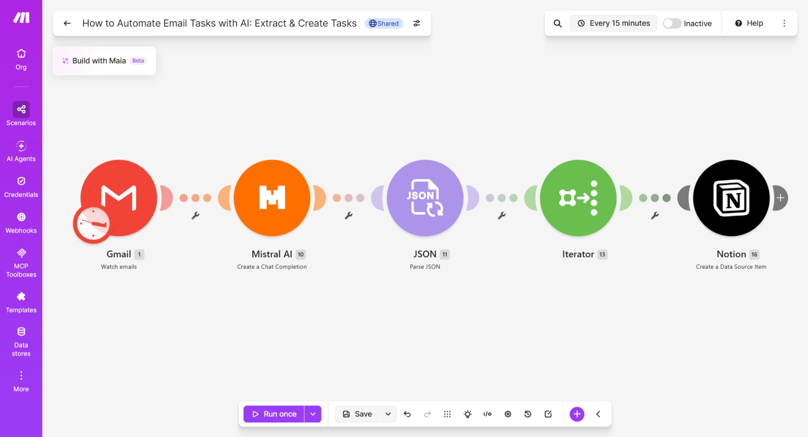

# How to Automate Email Tasks with AI: Extract & Create Tasks

A [Make.com](https://www.make.com) scenario that reads your incoming Gmail messages, uses an AI model (Mistral) to pull out the action items, and adds each one as a task in a Notion database.

▶️ **Video tutorial:** [watch on YouTube](https://www.youtube.com/watch?v=5LgaE_qQGzI)

[](https://www.youtube.com/watch?v=5LgaE_qQGzI)

## The scenario



```
Gmail (new email) ──► Mistral AI (extract tasks as JSON) ──► Parse JSON ──► Iterator ──► Notion (create task)
```

## What it does

1. **Watch new emails** (Gmail): checks your Inbox for new messages.
2. **Extract action items** (Mistral AI, `mistral-medium-latest`): sends the subject and body to the model with a system prompt (see [`prompt.md`](prompt.md)). The model returns a JSON array of tasks. Each task has:
   - `task`: a short description of the action
   - `assignee`: the person responsible, if one is named (first-person phrases like "I will" are assigned to the sender)
   - `due_date`: an absolute date (`YYYY-MM-DD`), worked out from relative phrases like "next Friday" using the email's sent date
3. **Parse JSON**: turns the model's reply into structured data.
4. **Iterator**: handles each task one at a time.
5. **Create item** (Notion): adds one row per task to your tasks database.

> **The AI can make mistakes.** It can miss an action item, invent one, assign it to the wrong person or get the due date wrong. Check each task against the original email before acting on it.

## Requirements

- A Make.com account (the free plan is enough to try it)
- A Gmail account
- A Mistral AI API key ([console.mistral.ai](https://console.mistral.ai))
- A Notion workspace with a tasks database

## Notion database setup

Create a database (for example "Tasks Tracker") with these properties:

| Property    | Type      | Filled with                     |
|-------------|-----------|---------------------------------|
| Task name   | Title     | `task` from the AI              |
| Owner       | Text      | `assignee` from the AI          |
| Due Date    | Text      | `due_date` from the AI          |
| Source      | Text      | Email subject                   |
| Date Added  | Date      | Date the task was created       |

You can add other columns (Status, Priority, Effort level...). The scenario leaves them empty.

## Installation

1. Download [`Action Item Extraction with AI.blueprint.json`](Action%20Item%20Extraction%20with%20AI.blueprint.json).
2. In Make, create a new scenario, open the **⋯** menu, choose **Import Blueprint** and select the file.
3. Reconnect each module to your own accounts:
   - **Gmail**: add your Gmail connection.
   - **Mistral AI**: add a connection with your API key.
   - **Notion**: add your Notion connection, then pick **your** database in the "Create item" module and check the field mapping.
4. In the **Parse JSON** module, rebuild the data structure if Make asks for it (an array of objects with `task`, `assignee`, `due_date`).
5. Click **Run once** and send yourself a test email, for example:
   > Hi, can you send me the Q3 report by next Friday? I'll book the meeting room for Tuesday.
6. Turn on scheduling when you are happy with the result.

## Customizing

- **Prompt**: change the extraction rules in the Mistral module. [`prompt.md`](prompt.md) has a readable copy.
- **Model**: any Mistral model works. A lower `temperature` (for example `0.2`) gives more consistent output for extraction.
- **Email filter**: in the Gmail module, limit the trigger to a label, a sender or keywords so you don't process every email.
- **Other apps**: swap Notion for Todoist, Trello, Asana, Google Tasks, etc.

## Privacy and security

- **Email contents are sent to Mistral AI** for processing. Don't use this on mailboxes with data you are not allowed to share with a third-party AI provider. Filtering the trigger (see above) reduces what gets sent.
- **No credentials are included in this repository.** API keys and OAuth tokens stay in your Make connections and are never exported in the blueprint.
- **Emails are untrusted input.** Someone could write an email designed to trick the AI (prompt injection) and create fake or misleading tasks. In this scenario the impact is limited to rows in your Notion database, but review tasks before acting on them.

## License

[MIT](LICENSE)
